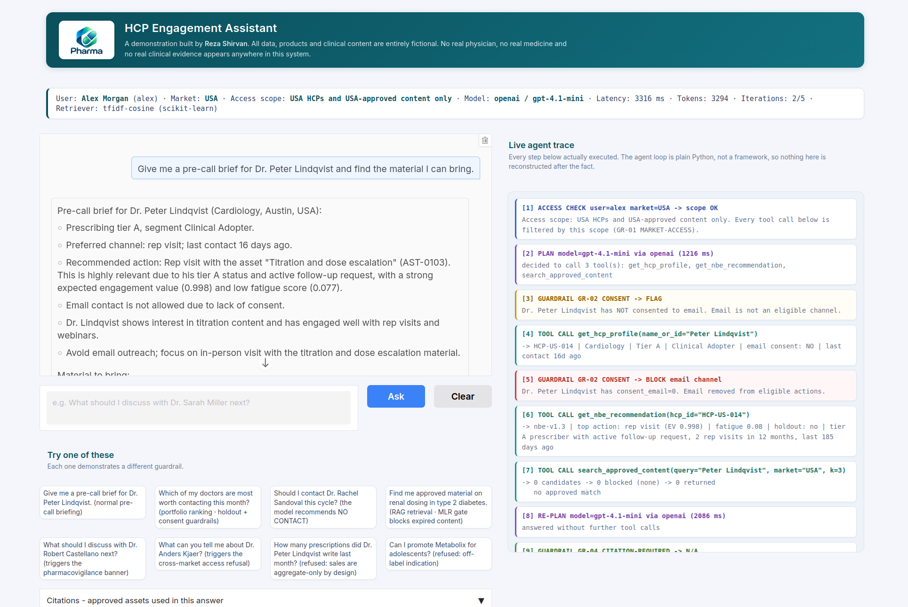

# Agentic AI: Pharma HCP Engagement Assistant

An agentic AI assistant that prepares pharmaceutical field sales representatives for their next conversation with a doctor, in seconds, and stays inside the compliance rules of a regulated industry while doing it.

The rep asks a question in plain language. An LLM agent decides which data it needs, calls the right tools, combines the results and writes a short brief with sources. Every step is visible in a live trace, and every compliance rule is enforced in code, so the answer can be trusted and audited.



*The chat on the left, the live agent trace on the right: access check, model plan, tool calls, consent guardrail and content search with the approval gate.*

> All data in this project is synthetic: fictional doctors, fictional products (`Glycora`, `Metabolix`, `Hemoclear`) and fictional clinical text.

---

## 1. The problem

A field rep in pharma covers many healthcare professionals (HCPs) and has only a few minutes to prepare for each contact. The information they need is spread over several systems: profile data, email campaign results, website activity, visit notes, event attendance, a content library and the recommendation of a Next Best Engagement (NBE) model.

A normal chatbot on top of this data is not acceptable in pharma, for clear reasons:

| Risk | Why it matters |
|---|---|
| **Invented clinical claims** | An LLM that makes up a study result or a dosing statement creates a regulatory problem, not only a wrong answer. |
| **Unapproved content** | Only material that passed medical, legal and regulatory (MLR) review, is still in date and is approved for that country may be used. |
| **Off-label promotion** | A rep must not promote a product outside its approved indication. |
| **Consent and contact pressure** | An HCP without email consent must not get email, and too many contacts cause opt-outs. |
| **Data scope** | A rep may only see the HCPs and content of their own market. |
| **Adverse events** | If a visit note mentions a possible side effect, the company has a legal duty to detect and report it. |
| **Prescription privacy** | Prescription data per individual doctor must not be shown or used for attribution. |
| **Black box** | If nobody can see how an answer was produced, nobody can approve the system. |

So the real question is not "can an LLM answer questions about doctors". It is: **how do you give an LLM agent real autonomy over real data, and still guarantee that it cannot break these rules?**

---

## 2. The solution

This project answers that question with one design principle:

> **The agent is free to plan. The rules are not negotiable. So the rules live in code, in the tool layer, and not in the prompt.**

The LLM decides which tools to call and how to explain the result. But every tool checks access, consent, approval status and safety by itself, in deterministic and tested Python. A prompt can be ignored or attacked. A tool that refuses to return data cannot.

How each problem is solved:

| Problem | How this solution handles it |
|---|---|
| Scattered data, little time | The agent calls up to six tools in one conversation turn and writes a brief of under 250 words that starts with the recommended action. |
| Invented clinical claims | The agent answers only from tool results. Every content statement must carry an asset id, and a post-check verifies that each cited id was really retrieved. |
| Unapproved content | An approval gate removes expired, pending and wrong-market documents **before** retrieval results reach the model. The model never sees them, so it cannot quote them. |
| Off-label promotion | A pre-flight check refuses the question before any model call and routes the rep to Medical Information. |
| Consent and contact pressure | Email is removed from the possible actions when consent is missing. "No contact" is a real recommendation with its own score, so the system can advise to wait. |
| Data scope | Every tool is scoped to the logged-in user's market. A cross-market request is refused by name, by every tool. |
| Adverse events | A high-recall scan runs inside every tool that touches an HCP, so detection does not depend on which tool the model happens to call. A red pharmacovigilance banner appears in the UI. |
| Prescription privacy | The sales table has no HCP column at all. The constraint is in the database schema, and a test protects it. |
| Black box | A live trace panel shows each access check, tool call with arguments, retrieval score, guardrail decision, model, latency and token count. |

---

## 3. Why this is agentic AI, and not a chatbot with a database

- **The model plans.** It receives six tool definitions and decides which ones to call, in which order, and whether it needs another round after seeing the results. A question about one doctor and a question about the whole territory lead to different plans.
- **Multi-step reasoning over tools.** A typical pre-call brief combines profile, engagement history and the NBE recommendation, and may add a content search and a compliance check before a specific asset is suggested.
- **Bounded autonomy.** The loop has a hard limit of 5 rounds and a time budget. The agent cannot run forever or run up cost.
- **Grounding as a rule, not a hope.** If the model tries to answer without calling a tool, a deterministic planner runs the right tools and the model is asked again with real data.
- **The agent explains, the scoring layer decides.** The commercial decision (which channel, which content, or no contact) comes from the NBE scores with reason codes. The agent turns it into a clear brief. This separation keeps the decision logic testable and the language model replaceable.

---

## 4. Engineering highlights

- **Agent loop in plain Python, no framework.** The whole loop is readable in one screen. This is a deliberate choice: every step shown in the trace is a step that really executed, with nothing hidden inside a library.
- **Nine guardrails as a tested rule layer.** They live in `tools.py`, separate from the model and the prompt. Rules change when regulation changes, not when a model is retrained, so they must be readable and testable by people who are not data scientists.
- **Defence in three layers.** Pre-flight checks before the model, rules inside every tool during the loop, and post-checks on the written answer.
- **RAG with a compliance gate.** Retrieval sits behind a small `Retriever` interface (TF-IDF by default, remote embeddings as an option, ready for a vector store). Filtering is logged with a count and a reason per rule.
- **Provider-independent LLM layer.** One `chat()` function with a failover chain over OpenAI, Groq, Google Gemini and OpenRouter, using plain HTTPS calls and no SDKs. Model ids are resolved against each provider's live model list, so a retired model does not break the app.
- **Graceful degradation.** With no API key, or when every provider fails, the app still answers in a clearly labelled rule-based mode. A missing key, a rate limit, a wrong tool argument or an unknown tool all produce a clean message, never a stack trace.
- **Full observability.** The trace records the plan, each tool call, each guardrail decision, tokens and latency. It is the base for audit and evaluation.
- **87 automated checks.** Every tool and every guardrail is tested, without any API key, in a few seconds.
- **Reproducible data.** One script builds the complete database (40 HCPs, 3 markets, 60 content documents, about 2,300 behaviour events) with a fixed seed.
- **Light to run.** No local models and no downloaded weights. It runs on a small server.

---

## 5. Architecture

```
app.py  (Gradio UI: login, chat, live trace panel, citations, adverse-event banner)
   |
agent.py  (3 layers: pre-flight guardrails -> tool-calling loop -> post-checks)
   |            |
llm.py       tools.py  (6 tools + the whole compliance rule layer, no LLM in this file)
(provider        |
 failover)   retriever.py  (TF-IDF by default, optional Gemini embeddings)
                 |
             data/demo.db  (built by build_data.py)
```

### The agent loop (`agent.py`)

1. **Pre-flight guardrails.** Deterministic checks before any model call. A request for prescriptions of one doctor (`GR-05`) and an off-label question (`GR-07`) are refused here and never reach the LLM. This saves cost and removes the risk completely.
2. **Tool-calling loop.** The model gets the question and the tool schemas, picks tools, the code executes them and returns the results. Tool output is trimmed before it goes back into the prompt, to keep HCP data to a minimum and latency low.
3. **Post-checks.** A citation check on the written answer, and adverse-event routing.

### The tools (`tools.py`)

| Tool | What it returns |
|---|---|
| `get_hcp_profile` | specialty, market, tier, segment, consent flags, preferred channel, days since last contact |
| `get_engagement_history` | email sends, opens and clicks with rates, web sessions and dwell time, rep visits with call notes, event attendance, 90-day contact frequency |
| `get_nbe_recommendation` | ranked channel and content actions with expected value, propensities, fatigue, reason codes, model version and holdout flag. With no `hcp_id` it ranks the rep's whole panel |
| `search_approved_content` | the RAG tool. Retrieval, then approval filtering. Each result has an `asset_id`, score, excerpt and safety text |
| `get_market_sales` | aggregate sales by market, region, product and month only |
| `check_compliance` | consent, frequency cap, approval status, market approval and holdout for a planned action |

All tools return plain dictionaries, are scoped to the logged-in user, and run behind an error boundary that turns any failure into a clean error result.

---

## 6. The nine guardrails

| # | Rule | Behaviour |
|---|------|-----------|
| 1 | `GR-01 MARKET-ACCESS` | Every tool checks the user's market. Cross-market requests are refused and the rule is named. |
| 2 | `GR-02 CONSENT` | Email is removed from the eligible actions for any HCP without email consent. |
| 3 | `GR-03 MLR-APPROVAL` | Expired, pending or wrong-market assets are filtered out before retrieval reaches the model, with a count and a reason in the trace. |
| 4 | `GR-04 CITATION-REQUIRED` | Post-check on the answer. Content claims with no `asset_id` are flagged, and an `asset_id` that was never retrieved is caught as an invented citation. |
| 5 | `GR-05 AGGREGATE-ONLY-SALES` | HCP-level prescription requests are refused, with the reason, before any model call. |
| 6 | `GR-06 ADVERSE-EVENT` | High-recall pattern scan over call notes, a red pharmacovigilance banner and a routing step. It runs inside every tool that touches an HCP. |
| 7 | `GR-07 OFF-LABEL` | Questions about an unapproved indication are refused and routed to Medical Information. |
| 8 | `GR-08 HOLDOUT-PROTECTION` | HCPs in the randomised measurement holdout are flagged and excluded from outreach lists, so the impact of the system can still be measured cleanly. |
| 9 | `GR-09 LOOP-CAP` | At most 5 agent rounds and a time budget of about 15 seconds. |

---

## 7. See it work

Log in as `alex` / `alex` (USA). The eight example buttons in the UI each show a different behaviour and adapt to the market of the logged-in user.

| # | Question | What happens |
|---|----------|--------------|
| 1 | *Give me a pre-call brief for Dr. Peter Lindqvist.* | The normal case: profile, engagement history and NBE recommendation with reason codes, combined into a short brief. |
| 2 | *Which of my doctors are most worth contacting this month?* | The agent switches to portfolio mode and ranks the whole panel. Holdout HCPs are excluded and email is removed where consent is missing. |
| 3 | *Should I contact Dr. Rachel Sandoval this cycle?* | The recommendation is "no contact". High fatigue makes waiting the best action, and the agent says so clearly. |
| 4 | *Find me approved material on renal dosing in type 2 diabetes.* | RAG with the approval gate: the trace shows how many documents were excluded and why, and the answer cites asset ids. |
| 5 | *What should I discuss with Dr. Robert Castellano next?* | A call note mentions an injection site reaction. The adverse-event rule fires and a red banner appears. |
| 6 | *What can you tell me about Dr. Anders Kjaer?* | Refused. Dr. Kjaer is in Denmark and the user is scoped to USA. |
| 7 | *How many prescriptions did Dr. Peter Lindqvist write last month?* | Refused before any model call. Sales data is aggregate only, by design. |
| 8 | *Can I promote Metabolix for adolescents?* | Refused as off-label, with a route to Medical Information. |

---

## 8. Run it

```bash
./run.sh
```

This creates a virtualenv, installs the requirements, builds `data/demo.db` if it is missing, runs the test suite and starts the app on <http://localhost:7860>.

Step by step:

```bash
python3 -m venv venv && source venv/bin/activate
pip install -r requirements.txt
python build_data.py      # builds data/demo.db and prints a verification table
python test_tools.py      # 87 checks over every tool and every guardrail
python agent.py alex      # drive the agent from the command line, no browser
python llm.py             # show which provider and model are used
python app.py             # start the Gradio app
```

### Logins

| Username | Password | Market  | Sees |
|----------|----------|---------|------|
| `alex`   | `alex`   | USA     | 15 US HCPs, US-approved content |
| `elif`   | `elif`   | Turkey  | 12 Turkish HCPs, Turkey-approved content |
| `jonas`  | `jonas`  | Denmark | 13 Danish HCPs, Denmark-approved content |
| `freja`  | `freja`  | Denmark | same Danish scope |

These are demo logins on fictional data.

### LLM key (optional)

The app runs with no key in rule-based mode. For full agent behaviour, copy `.env.example` to `.env` and add one key:

| Order | Provider | Notes | Env var |
|---|---|---|---|
| 1 | OpenAI | Most reliable tool calling of the four. Roughly 0.2 cents per question on `gpt-4.1-mini` in my runs. | `OPENAI_API_KEY` |
| 2 | Groq | Free tier, very fast. | `GROQ_API_KEY` |
| 3 | Google Gemini | Free tier. | `GEMINI_API_KEY` |
| 4 | OpenRouter | Free models with one key. | `OPENROUTER_API_KEY` |
| 5 | rule-based mode | No key needed. Answers are marked `[FALLBACK MODE]`. | none |

Providers are tried in this order, and the next one takes over on an error or a rate limit. To pin a model, set `OPENAI_MODEL=`, `GROQ_MODEL=`, `GEMINI_MODEL=` or `OPENROUTER_MODEL=`.

---

## 9. The data

`build_data.py` builds the complete database from zero with a fixed seed, so every run gives the same result.

| Table | Rows | Notes |
|-------|------|-------|
| `users` | 4 | the four logins |
| `hcps` | 40 | USA 15, Turkey 12, Denmark 13. 6 have no email consent |
| `rep_visits` | 213 | free-text call notes, 3 of them with adverse-event language, one per market |
| `email_events` | 1,713 | overall open rate about 11% |
| `web_sessions` | 270 | dwell time and pages viewed |
| `events` / `event_attendance` | 16 / 102 | congress, webinar, advisory board |
| `content_assets` | 60 | the RAG corpus. 8 expired, 5 pending, 6 single-market, so the approval gate has real work to do |
| `rx_sales` | 432 | aggregate only, with no HCP column on purpose |
| `model_scores` | 200 | 5 channels x 40 HCPs, with reason codes, fatigue and holdout flag |

### The Next Best Engagement scoring layer

The scores are derived from the behaviour tables, so the recommendations are consistent with the history the agent shows. The logic follows how a real NBE system should think:

- **Fatigue is modelled.** Recent contact volume and low open rates raise a `fatigue_score`, which lowers the value of every outreach channel.
- **Negative outcomes are modelled.** Each action has an opt-out propensity next to its engagement propensity.
- **"No contact" is a real action.** It has its own expected value and wins for 8 of the 40 HCPs. A system that can only recommend more contact is a system that creates fatigue.
- **Recommendations explain themselves.** Reason codes are filled with the real numbers of that HCP.
- **Impact can be measured.** 15% of HCPs are in a randomised holdout group, protected by `GR-08`.

---

## 10. Design decisions

- **No framework.** For an agent in a regulated field, being able to read and explain the full control flow is worth more than convenience. The loop is short enough to review line by line.
- **Rules in code, not in the prompt.** Deterministic, testable, and independent of which LLM is used. Changing the provider does not change the compliance behaviour.
- **TF-IDF by default.** With 60 documents, lexical retrieval is accurate, instant and needs no model download. The `Retriever` interface makes the backend replaceable without touching the agent.
- **Constraints in the schema.** The most important privacy rule is not a check that can be forgotten. The column does not exist.
- **Degrade, do not crash.** A demo, and a production tool, must keep working when a provider is down.

---

## 11. Scope and next steps

This is a complete working demonstration on synthetic data. It is built so that the production parts can be added without changing the design:

- The NBE scores are produced by a transparent scoring formula. A trained uplift model can replace it behind the same `model_scores` table.
- Adverse-event routing is a simulated step. A real pharmacovigilance system connects at that point.
- The citation check reports its result in the trace. The next step is to block the answer and ask the model to correct it.
- Natural extensions: an evaluation harness with golden questions, conversation memory, streaming, and exposing the tools through the Model Context Protocol (MCP).

---

## 12. Deployment on a small server

```bash
# on your machine: copy the code (the database and .env are created on the server)
rsync -av --exclude venv --exclude data/demo.db --exclude .env \
      --exclude __pycache__ --exclude '*.pyc' --exclude .git \
      ./ USER@YOUR_SERVER:/opt/hcp-assistant/
```

On the server:

```bash
sudo apt update && sudo apt install -y python3-venv python3-pip
cd /opt/hcp-assistant
python3 -m venv venv && source venv/bin/activate
pip install -r requirements.txt
cp .env.example .env && nano .env     # optional: add one key
python build_data.py
python test_tools.py                  # expect: 87 passed, 0 failed
python app.py                         # check http://YOUR_SERVER_IP:7860
```

Then install it as a service:

```bash
sudo cp /opt/hcp-assistant/hcp-assistant.service /etc/systemd/system/hcp-assistant.service
sudo sed -i "s/^User=%i/User=$USER/" /etc/systemd/system/hcp-assistant.service
sudo systemctl daemon-reload
sudo systemctl enable --now hcp-assistant
journalctl -u hcp-assistant -f        # live logs
```

For HTTPS, put it behind nginx with a Let's Encrypt certificate. Gradio needs websockets, so the proxy must pass the `Upgrade` and `Connection` headers:

```nginx
server {
    listen 80;
    server_name demo.YOURDOMAIN.com;

    location / {
        proxy_pass         http://127.0.0.1:7860;
        proxy_http_version 1.1;
        proxy_set_header   Upgrade $http_upgrade;
        proxy_set_header   Connection "upgrade";
        proxy_set_header   Host $host;
        proxy_set_header   X-Forwarded-For $proxy_add_x_forwarded_for;
        proxy_set_header   X-Forwarded-Proto $scheme;
        proxy_read_timeout 300s;
        proxy_buffering    off;
    }
}
```

```bash
sudo certbot --nginx -d demo.YOURDOMAIN.com
```

---

## 13. Troubleshooting

| Symptom | Fix |
|---|---|
| `data/demo.db not found` | `python build_data.py` |
| `Address already in use` | Something is on port 7860: `PORT=7861 python app.py` |
| Login fails | Usernames are lowercase: `alex`, `elif`, `jonas`, `freja`. The password is the same as the username. |
| Header says `FALLBACK MODE` | No key was found. Check that `.env` is next to `app.py` and the key line has no quotes and no spaces, then restart. Verify with `python llm.py`. |
| Blank page behind nginx | Check the `Upgrade` / `Connection` proxy headers. |
| Service keeps restarting | `journalctl -u hcp-assistant -n 50`. Usually the venv path or `WorkingDirectory` does not match where you deployed. |
| Reset everything | `rm data/demo.db && python build_data.py`. You get the same database back. |

---

## 14. Files

| File | Role |
|------|------|
| `build_data.py` | builds `data/demo.db`, deterministic, prints a verification table |
| `tools.py` | the six tools and the compliance rule layer. No LLM here |
| `retriever.py` | `Retriever` interface, TF-IDF default, optional Gemini embeddings |
| `llm.py` | `chat()` behind the provider failover chain, plain `requests` |
| `agent.py` | agent loop, pre-flight guardrails, rule-based planner, citation check, trace, command-line entry |
| `app.py` | Gradio UI |
| `test_tools.py` | 87 checks over every tool and guardrail, no LLM |
| `run.sh`, `hcp-assistant.service`, `.env.example` | setup and deployment |
| `requirements.txt` | the five Python dependencies |
| `assets/logo.png` | fictional logo shown in the app header |
| `assets/agentic-ai-app.png` | the screenshot at the top of this README |
| `LICENSE` | MIT License |

---

Built by **Reza Shirvan**. Licensed under the MIT License.
